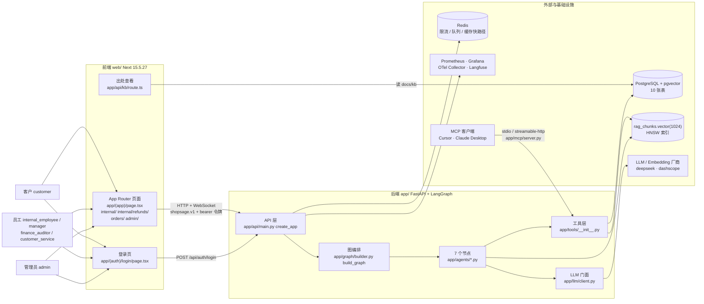
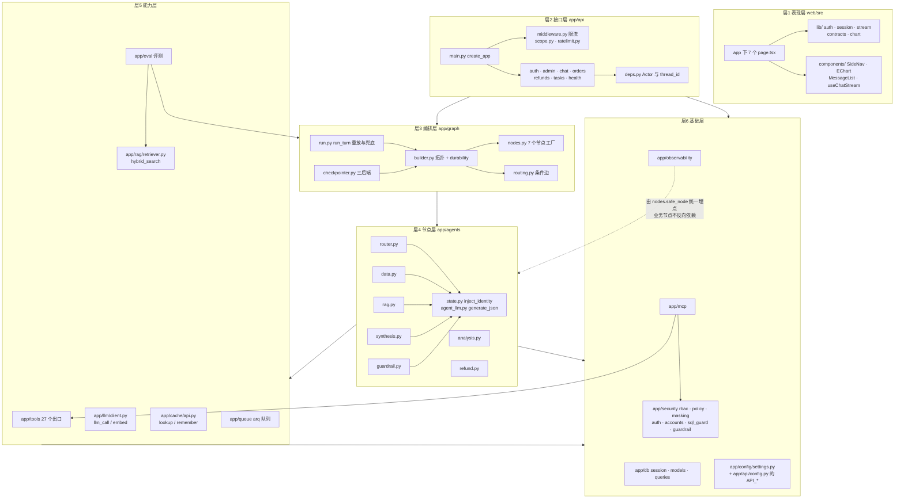
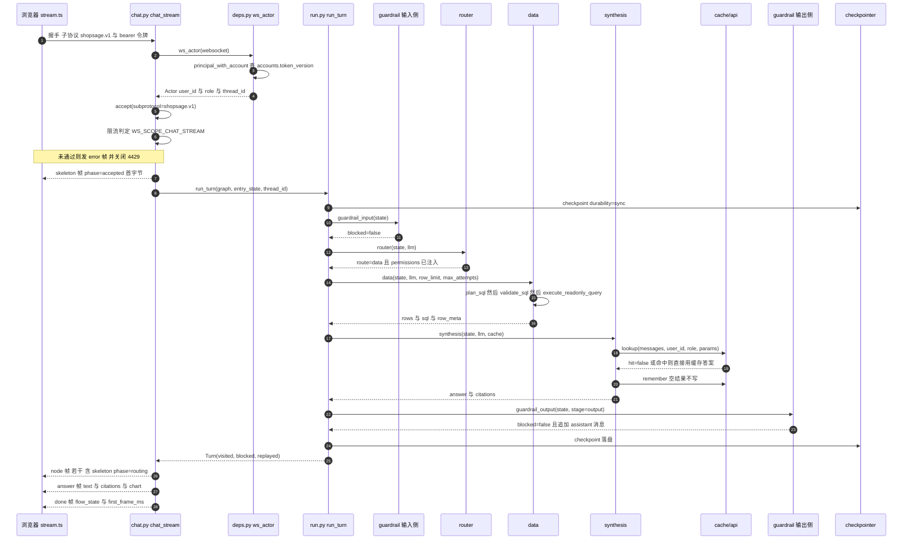
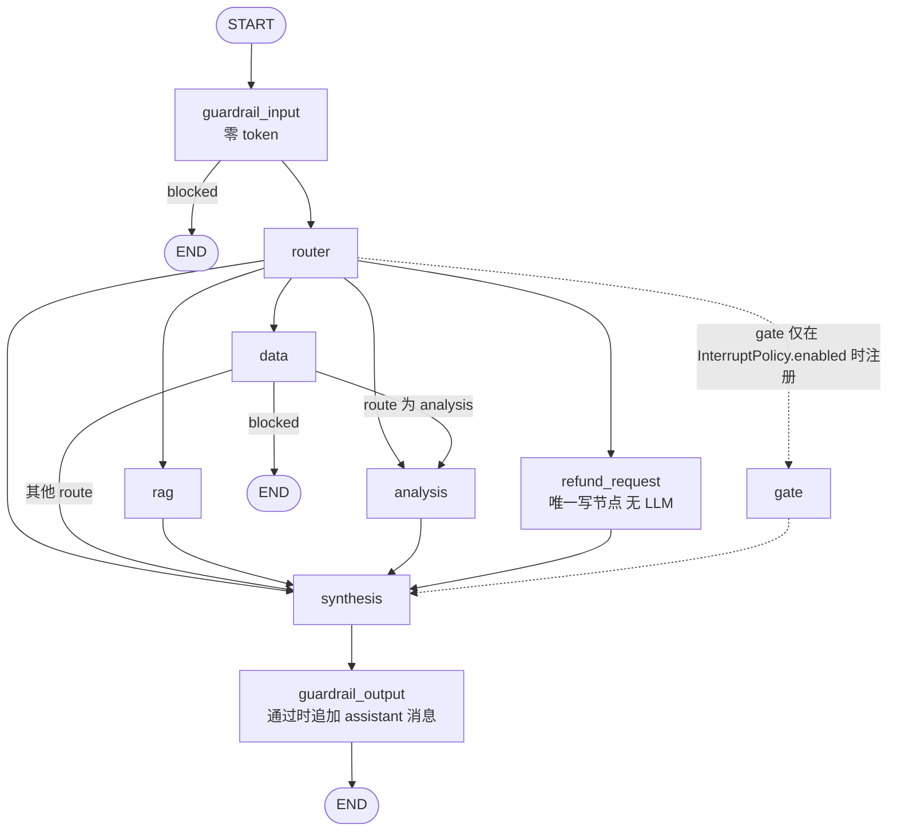

# 架构图集（Mermaid）

> **约定**：实线 = 代码里能找到对应模块/类；虚线 + `?` = 存在但本次无法在代码里确证的结构。
> 每个节点括号里是**代码位置**，均可回查。四个图分别回答：谁在用（上下文）、怎么分层（依赖）、一次请求怎么走（时序）、图内部拓扑。

---

## 1. 系统上下文图

**读图要点**

- MCP 客户端**不经 API 层**，直接打工具层：`app/mcp/server.py:95` 的 `build_server` → `app/mcp/sync_calls.py` → `app/tools/`。
- 前端**不经过 Next 的服务端路由**转发 WS（`web/next.config.ts` 注释第 2 条：`rewrites` 不代理 WS 升级），所以后端必须 `--host 0.0.0.0`。

---

## 2. 分层模块依赖图

**三条写在代码里的依赖铁律**

1. `app/eval` **不 import FastAPI**（`docs/runbook/14.eval-runbook.md` §2.4）。
2. `app/mcp` **不 import `app.api` / fastapi / uvicorn / starlette**（`docs/runbook/15.mcp-runbook.md` §2.4）。
3. 六个 Agent 模块**不知道可观测性存在**：span 只在 `app/graph/nodes.py:215` 的 `safe_node` 里统一开（同文件 :191-204 有理由）。

---

## 3. 一次请求时序图（对客问答，WS 流式）

**三个"不看代码想不到"的点**

1. **骨架帧在跑图之前发** —— 所以"首帧 <1s"与模型快慢无关（`app/api/chat.py:548-551`）。
2. **node 帧是跑完图之后批量补发的**，不是实时的（`app/api/chat.py:553-590`）：`run_turn` 的 `on_event` 是同步回调，回调里 `await` 不了。
3. **checkpoint 用 `durability="sync"`** —— 每步都落盘，断点重放才成立（`app/graph/builder.py:89`）。

---

## 4. 图内部拓扑（与 `consolidated/modules/08-graph.md` 同源）

> `gate` 用虚线：**代码里存在**（`app/graph/nodes.py:373` 的 `make_gate`），但默认配置下**不会被注册进图** —— `app/graph/config.py:82` 的 `GATED_ROLES = frozenset()` 为空集，`app/graph/builder.py:108-110` 据此跳过注册。
