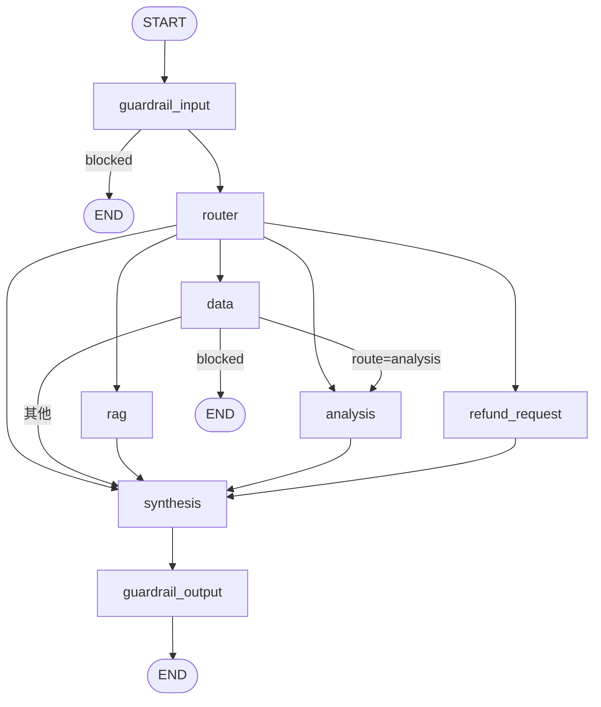

# 模块 08 · graph（LangGraph 编排与断点重放）

## 目的

把 7 个节点装配成一张**有状态、可持久化、可从断点重放**的图，并提供"跑一轮"的驱动（`run_turn`）。

## 关键结论

### 8.1 拓扑（`app/graph/builder.py:95-150` 的代码事实）



- **`gate` 节点不在这张图上**：`gated` 只在 `InterruptPolicy.enabled` 为真时注册，而 `GATED_ROLES` 默认是**空集**（`app/graph/config.py:82`）。原语保留（`make_gate`、`NODE_GATE`、`INTERRUPT`），但默认图里没有。→ 文档若写"有人工审批闸门"即错。
- `refund_request` 是**唯一写节点**，且不接收任何 runtime 注入（`app/graph/nodes.py:288-306`）。
- `data` 是岔路口：`route=analysis` → 继续 `analysis`；否则直通 `synthesis`；被兜底标死 → `END`（`app/graph/routing.py:69-95`）。

### 8.2 `durability="sync"`（最容易漏的一个参数）

LangGraph 1.x 默认是**异步**持久化。异步模式下"节点跑过了、checkpoint 还没落盘"，进程此刻挂掉就**没有断点可重放**。所以本仓把 `TURN_DURABILITY = "sync"` 钉进**每一次调用**（`app/graph/builder.py:89`、`graph_config()` :166-175）。代价是每步多一次写库往返（本地 < 10ms）。

### 8.3 断点重放（`app/graph/run.py:125 run_turn`）

- 用 `astream(stream_mode="updates")` 而不是 `ainvoke` —— 增量里带**节点名**，"这一轮跑了哪几步"是读出来的；
- 节点抛异常时**就地不兜底**（`app/graph/nodes.py:174 safe_node` 刻意不 try/except）：异常穿透 → LangGraph 不推进 `next` → `aget_state().next == (失败节点,)` → `ainvoke(None, cfg)` 从断点重放；
- 重放预算 `DEFAULT_REPLAY_BUDGET = 1`（`app/graph/run.py:52`），用尽后写 `failure_update()` 兜底（`as_node=target` 不能省，否则无限重放）；
- **可重试错误（`RetryableToolError`）不兜**，原样抛给队列（`app/graph/run.py:166-168`）。

### 8.4 兜底分两类（`app/graph/nodes.py:105 NETWORK_NODES` / `:134 failure_update`）

| 类别 | 节点 | 失败后 |
|---|---|---|
| 网络型 | data / rag / analysis / refund_request | 写 `refusals` 后**继续**跑 → synthesis 如实说"这块没拿到" |
| 收口型 | synthesis / guardrail_output | **必须停**：`blocked=True` + 固定话术 `FALLBACK_MESSAGE`（`app/graph/nodes.py:91`） |

### 8.5 checkpointer 三选一（`app/graph/checkpointer.py:106 open_checkpointer`）

`memory`（默认，重启即丢）/ `postgres`（`AsyncPostgresSaver`）/ `redis`。由 `CHECKPOINT_BACKEND` 决定，默认 `memory`（`app/api/config.py:178`）。生产配 `postgres`（`env.list.example:75`）。

### 8.6 会话隔离键 = `thread_id` = `c{uid}:{session}` / `e{emp_id}:{session}`

前缀取**主体类别**（变更 001 改的），否则员工 `emp_id=7` 与客户 `user_id=7` 会共用一份 checkpoint（`app/api/deps.py:176-199`）。

## 实际用法

```python
# 编译 + 跑一轮
graph = compile_graph(checkpointer=saver)                # app/graph/builder.py:153
turn  = await run_turn(graph, state, thread_id="c2:abc") # app/graph/run.py:125
turn.visited   # 这一轮真正跑过的节点（有序）
turn.blocked / turn.replayed / turn.exhausted / turn.interrupt
```

## 待办 / 已知边界

- `issues/007`（WS 断连忙等锁死事件循环）已在 `app/api/chat.py:468-486` 修；图侧无关联改动。
- `app/graph/config.py:31 SENSITIVE_ROUTES = ()` 为空：闸门即便打开也无"默认敏感分支"。
- ⚠️ Redis checkpointer 需要 Redis Stack 模块（`app/graph/checkpointer.py:187 _require_redis_modules`），本机是否具备未知 —— 生产默认走 postgres，不影响。

## 坑（来自 `docs/runbook/8.graph-runbook.md` §10.1，共 12 条）

| 坑 | 症状 |
|---|---|
| Windows 上 psycopg 异步不能在 `ProactorEventLoop` 上跑 | 必须 `ensure_compatible_event_loop()`（`app/graph/checkpointer.py:91`），且要在建事件循环**之前** |
| 条件边目标映射漏写 `END` | `get_graph()` 排序时 `TypeError: '<' not supported between NoneType and str` |
| 用 `add_node(error_handler=...)` | 同上 —— 图结构不再可验证，所以兜底改成节点内 try/except |
| `route_by_intent` 返回**节点名**，映射表键必须是节点名 | 新增 route 时运行期 `KeyError`（`app/graph/builder.py:181-212` 有长注释） |
| `aupdate_state` 不传 `as_node` | 失败节点又被排进 `next` → 无限重放 |

## 来源

- `docs/modules/8.graph.md`（46 行）、`docs/runbook/8.graph-runbook.md`（1039 行）
- 代码：`app/graph/*.py`；测试：`tests/graph/test_graph_*.py`（8 个文件）
